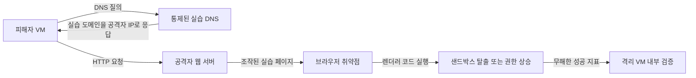

# GNS3 DNS 스푸핑–브라우저 취약점 실습 조사

> 조사일: 2026-10-29  
> 범위: 소유하거나 명시적으로 허가받은 격리 VM 실습 환경

## 결론

DNS 스푸핑만으로 리버스 셸을 얻을 수는 없다. DNS 스푸핑은 피해 브라우저를 공격자가 준비한 웹 서버로 유도하는 단계이고, 그 뒤에 다음 단계가 모두 성공해야 OS 수준 코드 실행으로 이어진다.



따라서 “한 번 접속하면 셸 획득”은 보통 단일 취약점이 아니라 **브라우저 RCE + 샌드박스 탈출/권한 상승 + 후속 페이로드** 체인이다. 버전이 일치해도 OS 빌드, 패치, CPU 아키텍처, ASLR 및 브라우저 완화 기능에 따라 재현 결과가 달라진다.

파일시스템 전체를 파괴할 수 있는 정도의 권한을 기술적으로 표현하면 **Linux UID 0 또는 Windows SYSTEM 권한의 임의 코드 실행**이다. `sudo` 명령 자체는 암호와 sudo 정책에 좌우되므로 취약점의 권한 수준을 판정하는 기준으로는 부정확하다. 이 문서에서는 파괴 동작을 실행하지 않고 UID 0/SYSTEM 토큰과 보호된 실습 디렉터리의 무해한 마커로 같은 권한을 입증한다.

또한 HTTPS 사이트는 DNS 응답만 바꿔도 인증서가 일치하지 않는다. HSTS, 인증서 고정, Secure DNS/DoH가 적용된 환경에서는 투명한 리디렉션이 더 어렵다. 실습에는 외부 도메인을 사칭하지 않고 예약 도메인인 `victim.lab.test` 같은 이름과 HTTP를 사용한다.

## 후보 버전 비교

| 우선순위 | 피해자 환경 후보 | 취약점 체인 | 공식 영향 범위 | 판단 |
| --- | --- | --- | --- | --- |
| 1 | Windows 7 SP1 32-bit, 2019-04-09 보안 업데이트 미적용 + Chrome 72.0.3626.119 | CVE-2019-5786 + CVE-2019-0808 | Chrome `< 72.0.3626.121`; Windows 7 SP1 32-bit/x64 | 실제 악용 체인으로 공개된 조합이다. Blink 코드 실행 뒤 Win32k 권한 상승을 사용한다. 오래된 Chrome 설치 파일의 출처와 무결성 확보가 어렵다. |
| 2 | Windows 10 1909 빌드 18363.1621 미만 + Chrome 90.0.4430.84 이하 | CVE-2021-21224 + CVE-2021-31955 + CVE-2021-31956 | Chrome `< 90.0.4430.85`; 관련 Windows 커널 취약점 패치 전 빌드 | 공개 분석에서 SYSTEM까지 도달한 체인이지만 3단계라 수업용 재현 난도가 높다. |
| 교육용 | Windows x64 격리 VM + Firefox 67.0.2 x64 | CVE-2019-11707 + CVE-2019-11708 | Firefox `< 67.0.3` 및 `< 67.0.4`; 두 취약점이 겹치는 버전은 67.0.2 이하 | 브라우저 RCE와 샌드박스 탈출의 역할을 분리해 설명하기 좋다. 최종 권한은 로그인 사용자이며 특정 Windows 빌드에서의 성공을 Mozilla가 보장하지는 않는다. |
| 비교용 | Windows 7 SP1 또는 당시 지원 Windows + IE11, 2020-02 보안 업데이트 미적용 | CVE-2020-0674 | IE11이 설치된 Windows 7 SP1, 8.1, Windows 10 여러 버전 등 | 공식 분류는 원격 코드 실행이지만 취약점 자체에 권한 상승은 없다. |
| Linux 개념 검증 | Ubuntu 18.04 LTS x64 + Firefox 67.0.2 + 수정 전 sudo 패키지 | CVE-2019-11707 + CVE-2019-11708, 그리고 별도 CVE-2021-3156 | Firefox 경계는 위와 같고 Ubuntu 18.04의 sudo 수정판은 `1.8.21p2-3ubuntu1.4` | 공개적으로 검증된 하나의 통합 체인이 아니다. 브라우저 단계와 UID 0 권한 상승 단계를 분리해 검증하는 연구 후보로만 사용한다. |

## 요구한 권한 수준 판정

| 후보 | 브라우저/샌드박스 단계 뒤 최종 권한 | root/SYSTEM 목표 충족 |
| --- | --- | --- |
| Firefox CVE-2019-11707 + CVE-2019-11708 | 로그인한 OS 사용자 | 아니요. 별도 로컬 권한 상승이 필요하다. |
| Chrome CVE-2019-5786 + Windows CVE-2019-0808 | Win32k 커널 권한 상승을 포함하므로 SYSTEM/커널급 임의 코드 실행 가능 | 예. 기존 후보 중 역사적 근거가 가장 명확하다. |
| IE11 CVE-2020-0674 단독 | 로그인한 OS 사용자 | 아니요. 취약점 자체에는 권한 상승이 없다. |
| PuzzleMaker 3-CVE 체인 | 공개 분석 기준 Windows SYSTEM | 예. 다만 3단계 체인이라 재현 난도가 높다. |
| Firefox 체인 + Linux CVE-2021-3156 | 개별 단계가 모두 성립하면 UID 0 | 개념상 예. 하나의 공개·검증된 브라우저 공격 체인으로 간주하면 안 된다. |

요구한 영향 수준에 가장 가까운 주 후보는 **Windows 7 SP1 32-bit + Chrome 72.0.3626.119 + CVE-2019-0808**이다. Linux의 `sudo`와 명령 형식은 다르지만 SYSTEM 권한은 보호된 OS 파일을 변경·삭제할 수 있는 동급의 최고 권한이다. Linux UID 0가 과제의 필수 조건이면 브라우저 침해와 로컬 권한 상승을 별도 실험으로 평가하는 구성이 더 정직하고 재현 가능하다.

### 후보 1: Firefox 67.0.2 체인

- [CVE-2019-11707](https://www.cve.org/CVERecord?id=CVE-2019-11707)은 `Array.pop` 처리 중 발생하는 타입 혼동 취약점이다. Firefox 67.0.3과 ESR 60.7.1에서 수정됐다. Mozilla는 실제 표적 공격에서 악용됐다고 밝혔다.
- [CVE-2019-11708](https://www.cve.org/CVERecord?id=CVE-2019-11708)은 손상된 콘텐츠 프로세스가 `Prompt:Open` IPC 매개변수를 악용해 비샌드박스 부모 프로세스에 영향을 주는 취약점이다. Firefox 67.0.4와 ESR 60.7.2에서 수정됐다.
- 두 취약점이 모두 남아 있는 명확한 교집합은 Firefox **67.0.2 이하** 또는 ESR **60.7.0 이하**다.
- 특정 Windows 버전은 공식 CVE 영향 범위에 고정돼 있지 않다. Windows 7 SP1 x64 같은 오래된 VM을 후보로 삼을 수 있지만, 실제 호환성은 선택한 공개 연구 자료와 동일한 빌드에서 따로 확인해야 한다.

이 후보는 브라우저 내부 메모리 취약점과 샌드박스 탈출을 설명하기에는 적합하지만, 최종 권한은 로그인 사용자 수준이다. 따라서 root/SYSTEM이 목표인 프로젝트의 최종 후보로는 부족하다.

### 후보 2: Chrome 72 + Windows 7 SP1 체인

- [CVE-2019-5786](https://www.cve.org/CVERecord?id=CVE-2019-5786)은 조작된 HTML 페이지로 유발되는 Blink 객체 수명 문제다. Chrome **72.0.3626.121**에서 수정됐다.
- [CVE-2019-0808](https://www.cve.org/CVERecord?id=CVE-2019-0808)은 Windows Win32k 메모리 객체 처리의 로컬 권한 상승 취약점이다. Windows 7 SP1 32-bit/x64와 Windows Server 2008 계열이 영향받았다.
- Google은 두 취약점이 실제로 결합돼 사용됐으며 Windows 7 32-bit가 관찰 대상이었다고 공개했다.
- 역사적 조건에 가까운 후보는 **Windows 7 SP1 32-bit, 2019-04-09 패치 미적용, Chrome 72.0.3626.119**다.

이 조합은 “브라우저 렌더러 → OS 권한 상승 → SYSTEM/커널급 실행” 경로가 명확해 요구한 영향 수준에 가장 가깝다. 오래된 Chrome 바이너리를 비공식 배포처에서 받는 것은 피해야 한다. 신뢰 가능한 원본과 해시를 확보하지 못하면 이 후보는 사용하지 않는다.

### 후보 3: Internet Explorer 11

[CVE-2020-0674](https://www.cve.org/CVERecord?id=CVE-2020-0674)는 Internet Explorer 스크립팅 엔진의 메모리 손상 RCE다. Windows 7 SP1의 IE11을 포함한 여러 당시 지원 Windows/IE 조합이 영향을 받았고 2020년 2월 보안 업데이트로 수정됐다. 단일 RCE CVE라는 점은 단순하지만, 브라우저 보호 모드와 OS 완화 기능을 우회해야 안정적인 네이티브 프로세스 실행으로 이어질 수 있다. 따라서 프로젝트의 주 후보보다는 비교 사례가 적합하다.

### Linux UID 0 개념 검증

[CVE-2021-3156](https://www.cve.org/CVERecord?id=CVE-2021-3156)은 sudo의 로컬 힙 오버플로로, 비특권 로컬 사용자가 root 권한을 얻을 수 있었던 취약점이다. Ubuntu 18.04 LTS에서는 `sudo 1.8.21p2-3ubuntu1.4`가 수정판이다.

Ubuntu 18.04 LTS x64와 Firefox 67.0.2를 같은 VM에 배치하는 것은 연구 후보가 될 수 있지만, Firefox 공개 체인은 주로 Windows x64 기준이고 Firefox 체인과 CVE-2021-3156이 하나의 실제 공격으로 연결됐다는 근거도 없다. 따라서 다음처럼 분리한다.

1. Firefox 단계에서는 브라우저 코드 실행과 샌드박스 경계를 사용자 권한까지만 검증한다.
2. sudo 단계에서는 이미 로컬 사용자 권한을 가진 상태를 시작점으로 UID 0 상승만 별도 검증한다.
3. 통합 시연이 필요하면 실제 root 익스플로잇 자동 연결 대신 교사용 검증 도구가 root 소유 attestation 마커를 만들도록 구성한다.

이 설계는 “브라우저에서 root까지 자동 연결되는 검증된 원클릭 취약점”이라고 주장해서는 안 된다.

## 최종 프로젝트 구성

필수 결과는 **DNS 스푸핑**과 **피해 VM이 먼저 연결하는 대화형 리버스 셸**이다. 재현성을 확보하면서 CVE 성공을 과장하지 않기 위해 두 트랙으로 나눈다.

1. **통합 시연 트랙**: 폐쇄망 전용 실습 브로커를 이용해 DNS 스푸핑부터 SYSTEM 리버스 셸까지 전체 화면 흐름을 확실하게 보여준다.
2. **실제 CVE 검증 트랙**: 브로커를 제거하고 취약 VM과 패치 VM을 비교해 브라우저 RCE, 샌드박스 탈출, 권한 상승 경계를 각각 관찰한다.

통합 시연 트랙의 SYSTEM 세션은 브로커를 의도적으로 LocalSystem 서비스로 구성했기 때문에 나타난다. 이는 실제 대화형 리버스 셸이지만 CVE를 통한 권한 상승 증거는 아니다. 실제 CVE 종단 간 성공은 일반 사용자 브라우저 프로세스에서 시작해 SYSTEM으로 전환되는 시점이 별도로 관찰됐을 때만 주장한다.

### 확정 피해 환경

| 항목 | 확정 사양 | 선정 근거 |
| --- | --- | --- |
| OS | Windows 7 SP1 32-bit, NT 6.1 build 7601 | CVE-2019-0808 공식 영향 대상이며 Google이 실제 체인에서 관찰한 환경이 Windows 7 32-bit임 |
| 취약 브라우저 | Chrome 72.0.3626.119 32-bit | CVE-2019-5786 수정판보다 이전인 마지막 실습 후보 |
| 브라우저 수정 대조군 | Chrome 72.0.3626.121 32-bit | CVE-2019-5786 공식 수정 버전 |
| 취약 OS 패치 기준 | 2019-03 월간 롤업 KB4489878까지 적용 | 실제 공격 시기와 가까운 기준선을 만들고 불필요하게 오래된 취약점을 줄임 |
| OS 수정 대조군 | KB4493472 월간 롤업 또는 KB4493448 보안 전용 업데이트 중 기존 업데이트 방식에 맞는 하나 | 2019-04 CVE-2019-0808 수정 기준. 이미지 구축 시 MSRC 제품별 표에서 포함 여부를 다시 확인함 |
| 실습 도메인 | 실행마다 고유한 `*.portal.lab.test` | 실존 도메인을 사용하지 않고 DNS 캐시 충돌을 줄임 |
| 웹 전송 | HTTP | HTTPS 인증서와 HSTS가 DNS 변조 관찰을 방해하지 않게 함 |

`winver`의 build 7601만으로는 패치 상태를 구분할 수 없다. 각 스냅샷에 설치된 KB 목록, Chrome 전체 버전과 x86 아키텍처, OS·브라우저 설치 파일의 공급자 서명과 해시를 함께 기록한다.

### 확정 스냅샷

| 이름 | Windows 상태 | Chrome 상태 | 확인할 경계 |
| --- | --- | --- | --- |
| `VULN-BOTH` | KB4489878까지, 2019-04 수정 미적용 | 72.0.3626.119 x86 | 전체 취약 기준선 |
| `PATCH-BROWSER` | `VULN-BOTH`와 동일 | 72.0.3626.121 x86 | 브라우저 RCE 단계 차단 |
| `PATCH-OS` | 2019-04 CVE 수정 적용 | 72.0.3626.119 x86 | Win32k 권한 상승 단계 차단 |

필요하면 두 수정 사항을 모두 적용한 `PATCH-ALL`을 추가한다. 각 스냅샷은 같은 원본 VM을 복제해 CPU, RAM, NIC와 나머지 설정을 동일하게 유지한다.

### 지원 VM과 자원

| 노드 | OS | vCPU | RAM | 디스크 | NIC |
| --- | --- | ---: | ---: | ---: | ---: |
| 피해자 | Windows 7 SP1 x86 | 2 | 2 GB | 30 GB | 1 |
| 공격자 | Kali Linux 2024.4 x64 | 2 | 4 GB | 25 GB | 1 |
| DNS 서버 | Ubuntu Server 22.04.5 LTS x64 | 1 | 1 GB | 8 GB | 1 |
| 웹 서버 | Ubuntu Server 22.04.5 LTS x64 | 1 | 1 GB | 10 GB | 1 |

GNS3 호스트는 RAM 16 GB 이상과 VT-x/AMD-V를 권장한다. 별도 관찰 VM 대신 GNS3 링크 캡처를 사용해 자원을 줄인다.

### 확정 GNS3 토폴로지

```text
                     [SW-LAB: 10.10.10.0/24]
                    /          |          |          \
[피해자 Windows 7]      [공격자 Kali]   [DNS 서버]   [정상 웹 서버]
   10.10.10.30          10.10.10.20   10.10.10.53    10.10.10.80
```

| 노드 | 인터페이스/IP | 게이트웨이 | DNS | 역할 |
| --- | --- | --- | --- | --- |
| 피해자 | `10.10.10.30/24` | 없음 | `10.10.10.53` | 취약 브라우저와 실습 브로커 |
| 공격자 | `10.10.10.20/24` | 없음 | 불필요 | ARP 기반 중간자, DNS 응답 변조, 공격 페이지, 역방향 세션 수신 |
| DNS 서버 | `10.10.10.53/24` | 없음 | 자체 | 실습 도메인의 정상 DNS 응답 |
| 웹 서버 | `10.10.10.80/24` | 없음 | `10.10.10.53` | 정상 기준 페이지와 접근 로그 |

- GNS3 Ethernet switch 하나만 사용하고 Cloud/NAT/라우터 노드는 연결하지 않는다.
- 네 VM 모두 외부 기본 경로, 두 번째 NIC 또는 호스트 브리지를 두지 않는다.
- 피해자는 계속 정상 DNS `10.10.10.53`에 질의한다. 정상 상태에서는 실습 도메인이 웹 서버 `10.10.10.80`을 가리키고, 변조 상태에서는 피해자가 받은 응답만 공격자 `10.10.10.20`으로 바뀐다.
- 스위치 환경에서 공격자는 기본적으로 피해자와 DNS 서버 사이의 유니캐스트 패킷을 볼 수 없다. DNS 변조 단계에서는 두 장비 사이의 ARP 매핑을 실습 공격자 MAC으로 바꿔 중간자 위치를 확보하고, 정상 통신을 유지하면서 DNS 응답만 변조한다.
- 피해자의 DNS 설정을 바꾸지 않으므로 단순한 DNS 서버 재설정과 같은 LAN의 ARP 기반 DNS 스푸핑을 구분할 수 있다.
- 역방향 세션은 피해자 `10.10.10.30`에서 공격자 `10.10.10.20`으로 직접 시작한다.
- 피해 VM의 실습 브로커는 정해진 도메인, 공격자 IP, 일회용 실행 ID가 모두 일치할 때만 세션을 시작한다.
- 브로커는 공격자 IP 고정, 단일 세션, 짧은 자동 종료, 실습 서브넷 외 통신 차단 조건을 적용한다.
- DNS 서버 링크와 피해자 링크를 동시에 캡처한다. DNS 서버가 보낸 원본 응답의 `10.10.10.80`과 피해자가 받은 변조 응답의 `10.10.10.20`을 같은 질의 ID와 시각으로 비교한다.
- 네 VM 모두 스냅샷을 만들고 공유 폴더와 공유 클립보드를 비활성화한다.
- 피해 VM의 시간 동기화와 자동 업데이트는 격리 상태에서 통제한다.
- 오래된 OS와 브라우저 설치 파일은 공급자 서명과 해시를 기록하고, 검증되지 않은 제3자 바이너리는 사용하지 않는다.

이 토폴로지는 별도 라우터 없이 같은 L2 네트워크에 있는 공격자가 ARP 기반 중간자 위치를 확보한 뒤 DNS 응답을 변조하는 시나리오다. ARP 중간자 단계와 DNS 응답 변조 단계를 별도 증거로 기록한다.

### 단계별 시연

1. **격리 검증**: 외부 라우트, NAT, Cloud 노드, 공유 폴더가 없고 모든 VM의 초기 스냅샷이 존재함을 기록한다.
2. **정상 기준선**: `portal.lab.test`가 정상 웹 VM을 가리키는 DNS 응답과 정상 페이지 요청을 PCAP으로 남긴다.
3. **DNS 스푸핑/응답 변조**: 동일 도메인이 공격자 VM 주소로 해석되고 피해자가 그 응답을 사용한 장면을 PCAP과 브라우저에서 확인한다.
4. **공격 페이지 도달**: 페이지와 공격자 웹 로그에 동일한 일회용 실행 ID가 나타나는지 확인한다.
5. **역방향 연결**: 피해 VM이 공격자 VM으로 먼저 연결한 TCP 흐름을 PCAP으로 확인한다.
6. **대화형 리버스 셸**: 공격자 콘솔 입력에 따라 피해 VM의 호스트명, 현재 신원, 작업 디렉터리처럼 서로 다른 결과가 왕복하는지 확인한다.
7. **SYSTEM 권한 확인**: 세션 신원이 `NT AUTHORITY\SYSTEM`인지 기록하고 전용 `C:\LabProof` 영역에서만 마커를 생성, 조회, 삭제한다.
8. **실패 대조군과 복구**: DNS 변조 제거 또는 브로커 비활성화 상태에서는 세션이 열리지 않는지 확인한 뒤 스냅샷으로 복구한다.

### 합격 기준

| 단계 | 필수 증거 |
| --- | --- |
| 격리 | GNS3에 NAT/Cloud 연결이 없고 외부 통신이 실패함 |
| DNS 스푸핑 | 동일 도메인의 응답이 정상 서버에서 공격자 IP로 바뀌고 피해자가 이를 사용한 PCAP |
| 웹 유도 | DNS 응답 직후 피해 브라우저 요청이 공격자 웹 로그에 기록됨 |
| 리버스 방향 | 피해 VM이 공격자 VM으로 먼저 시작한 연결의 5-tuple과 시각 |
| 대화형 셸 | 공격자 콘솔의 서로 다른 입력·출력이 왕복하고 실행 ID가 웹 로그와 일치함 |
| 권한 | `NT AUTHORITY\SYSTEM` 신원과 `C:\LabProof` 안의 마커 조작 성공 |
| 실패 대조군 | 브로커 비활성화 또는 DNS 원복 상태에서 같은 접속으로 세션이 열리지 않음 |
| 복구 | 세션 종료 후 스냅샷 복원, 열린 연결과 마커가 남지 않음 |

### 결과 해석

| 관찰 결과 | 정확한 주장 | 주장하면 안 되는 내용 |
| --- | --- | --- |
| DNS 응답이 공격자 IP로 변경됨 | 격리망에서 DNS 응답 변조를 재현함 | DNS만으로 코드 실행에 성공함 |
| 실습 브로커가 역방향 세션을 시작함 | 피해 VM이 먼저 연결하는 대화형 리버스 셸을 재현함 | 브라우저 CVE가 셸을 생성함 |
| SYSTEM 브로커 세션에서 SYSTEM 확인 | SYSTEM 권한 리버스 셸 동작을 시연함 | CVE로 일반 사용자에서 SYSTEM으로 상승함 |
| 브로커 없이 취약 VM에서만 SYSTEM 전환 관찰 | 해당 CVE 체인의 종단 간 재현에 성공함 | 버전만 맞췄으므로 CVE 성공이 입증됨 |

수정 버전에서도 같은 CVE 검증을 수행해야 한다. 취약 버전에서만 현상이 나타나고 패치 버전에서 사라져야 DNS 문제, 단순 브라우저 충돌, 실제 취약 동작을 구분할 수 있다.

## 확정 방어 대안: 권한 상승 패치

프로젝트의 단일 방어 대안은 **Windows 보안 업데이트로 CVE-2019-0808 권한 상승을 차단하는 것**으로 정한다.

| 방어 후보 | 구현 난도 | 실험상 한계 | 선택 여부 |
| --- | --- | --- | --- |
| DNS 스푸핑 차단 | 높음 | 같은 LAN에서는 ARP 보호, 관리형 스위치 기능 또는 DNSSEC 같은 추가 구성이 필요함 | 제외 |
| 리버스 셸 차단 | 낮음~중간 | 특정 IP·포트 차단은 다른 허용 포트나 프로세스 통신으로 우회될 수 있음 | 제외 |
| CVE-2019-0808 권한 상승 차단 | 낮음 | 브라우저의 사용자 권한 코드 실행 가능성은 남지만 SYSTEM 전환을 직접 차단함 | **선택** |

### 비교 방법

네트워크, DNS 변조, 공격 페이지, Chrome 버전은 모두 동일하게 유지하고 Windows 패치 상태만 바꾼다.

| 실행 | 피해자 스냅샷 | 예상 경계 |
| --- | --- | --- |
| 방어 전 | `VULN-BOTH` | 브라우저 단계 뒤 Win32k 권한 상승이 가능한 조건 |
| 방어 후 | `PATCH-OS` | 브라우저 단계가 발생하더라도 CVE-2019-0808을 통한 SYSTEM 전환 차단 |

`PATCH-OS`는 기존 업데이트 방식에 맞춰 2019-04 월간 롤업 KB4493472 또는 보안 전용 업데이트 KB4493448 중 하나를 적용한다. 실제 이미지 구축 시 MSRC의 Windows 7 SP1 x86 제품별 표에서 CVE-2019-0808 수정 포함 여부를 다시 확인한다.

### 방어 성공 기준

- DNS 응답 변조와 공격 페이지 접속은 방어 전후 모두 동일하게 관찰된다.
- 방어 후에는 CVE-2019-0808 단계에서 SYSTEM 권한으로 전환되지 않는다.
- `NT AUTHORITY\SYSTEM` 세션과 `C:\LabProof`의 SYSTEM 전용 마커 조작이 나타나지 않는다.
- 패치 적용 전후의 설치 KB 목록, PCAP, 브라우저 로그 및 프로세스 신원을 같은 실행 ID로 보존한다.

이 비교는 OS 권한 상승 패치의 효과만 분리해 검증한다. 실제 운영 환경에서는 브라우저와 OS 보안 업데이트를 모두 적용해야 한다.

## 프로젝트 산출물 제안

- GNS3 토폴로지와 각 인터페이스/IP 표
- 피해 OS 빌드, 패치 날짜, 브라우저 전체 버전 및 아키텍처
- DNS 변경 전후 PCAP
- HTTP 서버 접근 로그
- 피해 VM에서 공격자 VM으로 시작된 연결의 5-tuple과 시각
- 호스트명, SYSTEM 신원, 작업 디렉터리를 확인한 대화형 셸 기록
- 통합 시연 브로커 로그와 실제 CVE 검증 로그의 분리본
- 취약 버전과 수정 버전의 대조 결과
- 브라우저 프로세스 경계와 샌드박스 탈출 필요성을 설명한 흐름도
- 실습 전후 VM 스냅샷 식별자와 파일 해시
- 외부망 차단 및 허가 범위를 증명하는 안전 체크리스트

## 안전 범위

이 저장소에는 작동하는 브라우저 익스플로잇, 샌드박스 탈출 코드, 권한 상승 코드, 리버스 셸 페이로드, DNS 변조 명령 또는 파일시스템 파괴 명령을 포함하지 않는다. 실습은 본인이 소유하거나 담당 교수가 명시적으로 허가한 VM에서만 수행하고, 결과 확인은 격리망 내부의 무해한 지표로 제한한다.

## 공식·권위 자료

- Mozilla Foundation Security Advisory 2019-18: <https://www.mozilla.org/security/advisories/mfsa2019-18/>
- Mozilla Foundation Security Advisory 2019-19: <https://www.mozilla.org/security/advisories/mfsa2019-19/>
- Chrome Stable Channel Update (2019-03): <https://chromereleases.googleblog.com/2019/03/stable-channel-update-for-desktop.html>
- Google Security Blog, Windows 7 exploit chain 공개: <https://security.googleblog.com/2019/03/disclosing-vulnerabilities-to-protect.html>
- Microsoft MSRC CVE-2019-0808: <https://msrc.microsoft.com/update-guide/vulnerability/CVE-2019-0808>
- Microsoft Update Catalog KB4489878: <https://www.catalog.update.microsoft.com/Search.aspx?q=KB4489878>
- Microsoft Update Catalog KB4493472: <https://www.catalog.update.microsoft.com/Search.aspx?q=KB4493472>
- Microsoft Update Catalog KB4493448: <https://www.catalog.update.microsoft.com/Search.aspx?q=KB4493448>
- Microsoft MSRC CVE-2020-0674: <https://msrc.microsoft.com/update-guide/vulnerability/CVE-2020-0674>
- Chrome Stable Channel Update (2021-04): <https://chromereleases.googleblog.com/2021/04/stable-channel-update-for-desktop_20.html>
- Microsoft MSRC CVE-2021-31955: <https://msrc.microsoft.com/update-guide/vulnerability/CVE-2021-31955>
- Microsoft MSRC CVE-2021-31956: <https://msrc.microsoft.com/update-guide/vulnerability/CVE-2021-31956>
- Ubuntu USN-4705-1, CVE-2021-3156 수정: <https://ubuntu.com/security/notices/USN-4705-1>
- sudo 프로젝트 CVE-2021-3156 권고: <https://www.sudo.ws/security/advisories/unescape_overflow/>

버전 범위는 CVE CNA 기록과 Mozilla, Google, Microsoft, Ubuntu 및 sudo 프로젝트의 공급자 권고를 기준으로 작성했다.
