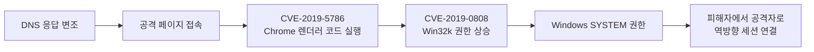

# GNS3 DNS 스푸핑–Chrome/Windows 취약점 체인 실습

> 조사일: 2026-10-29  
> 범위: 소유하거나 명시적으로 허가받은 격리 VM 실습 환경

## 프로젝트 목표

이 프로젝트는 다음 한 가지 사례만 다룬다.

- 브라우저 취약점: **Chrome CVE-2019-5786**
- OS 권한 상승 취약점: **Windows CVE-2019-0808**
- 피해 환경: **Windows 7 SP1 32-bit + Chrome 72.0.3626.119 32-bit**
- 전달 방식: 같은 내부망에서 ARP 기반 중간자 위치를 확보한 뒤 DNS 응답 변조
- 최종 관찰 목표: 피해 VM에서 공격자 VM으로 시작되는 SYSTEM 권한의 역방향 세션



DNS 스푸핑은 공격 페이지로 유도하는 전달 단계다. 브라우저 코드 실행, Windows 권한 상승, 역방향 연결은 각각 별도 단계이며 모두 성공해야 SYSTEM 세션으로 이어진다.

## 선택한 취약점

### CVE-2019-5786

- Chrome Blink의 객체 수명 처리 취약점이다.
- 조작된 HTML 페이지를 통해 브라우저 렌더러 코드 실행으로 이어질 수 있다.
- Chrome **72.0.3626.121**에서 수정됐다.
- 실습에서는 수정 전 버전인 **72.0.3626.119 32-bit**를 사용한다.

### CVE-2019-0808

- Windows Win32k의 메모리 객체 처리 과정에서 발생하는 로컬 권한 상승 취약점이다.
- Windows 7 SP1 32-bit와 x64가 공식 영향 대상이다.
- Google은 CVE-2019-5786과 CVE-2019-0808이 실제 공격에서 결합됐고 Windows 7 32-bit가 표적이었다고 공개했다.

원 공격자의 코드는 공개되지 않았지만 동일 환경을 대상으로 한 독립 공개 재현 체인은 존재한다. 다만 정확한 OS 빌드와 패치 상태에 민감하고 BSOD와 확률적 실패가 보고돼 있으므로, 버전만 맞춘다고 성공이 보장되지는 않는다.

## 확정 피해 환경

| 항목 | 사양 |
| --- | --- |
| OS | Windows 7 SP1 32-bit, NT 6.1 build 7601 |
| Chrome | 72.0.3626.119 32-bit |
| 취약 OS 기준 | 2019-03 월간 롤업 KB4489878까지 적용 |
| 제외할 수정 | 2019-04 KB4493472 월간 롤업 및 KB4493448 보안 전용 업데이트 |
| 실습 도메인 | 실행마다 고유한 `*.portal.lab.test` |
| 웹 프로토콜 | HTTP |

`winver`의 build 7601만으로 패치 상태를 구분할 수 없다. 설치된 KB 목록, Chrome 전체 버전과 x86 아키텍처, 설치 파일의 공급자 서명과 해시를 함께 기록한다.

## 피해자 스냅샷

| 이름 | Windows 상태 | Chrome 상태 | 용도 |
| --- | --- | --- | --- |
| `VULN-BOTH` | KB4489878까지 적용, 2019-04 수정 미적용 | 72.0.3626.119 x86 | 공격 조건 |
| `PATCH-OS` | CVE-2019-0808 수정 적용 | 72.0.3626.119 x86 | 권한 상승 방어 대조군 |

두 스냅샷은 같은 원본 VM을 복제해 CPU, RAM, NIC와 나머지 설정을 동일하게 유지한다.

## GNS3 환경

### 노드와 자원

| 노드 | OS | IP | vCPU | RAM | 디스크 |
| --- | --- | --- | ---: | ---: | ---: |
| 피해자 | Windows 7 SP1 x86 | `10.10.10.30/24` | 2 | 2 GB | 30 GB |
| 공격자 | Kali Linux 2024.4 x64 | `10.10.10.20/24` | 2 | 4 GB | 25 GB |
| DNS 서버 | Ubuntu Server 22.04.5 LTS x64 | `10.10.10.53/24` | 1 | 1 GB | 8 GB |
| 웹 서버 | Ubuntu Server 22.04.5 LTS x64 | `10.10.10.80/24` | 1 | 1 GB | 10 GB |

```text
                     [SW-LAB: 10.10.10.0/24]
                    /          |          |          \
[피해자 Windows 7]      [공격자 Kali]   [DNS 서버]   [정상 웹 서버]
   10.10.10.30          10.10.10.20   10.10.10.53    10.10.10.80
```

- GNS3 Ethernet switch 하나만 사용한다.
- 라우터, NAT, Cloud, 외부 기본 게이트웨이는 사용하지 않는다.
- 네 VM은 NIC 하나만 사용하며 호스트 브리지와 공유 폴더를 연결하지 않는다.
- 피해자의 DNS 서버는 `10.10.10.53`으로 고정한다.
- DNS 서버의 정상 응답은 `portal.lab.test → 10.10.10.80`이다.
- 공격 단계에서 피해자가 받은 응답만 `10.10.10.20`으로 바뀐다.
- 역방향 연결은 피해자 `10.10.10.30`에서 공격자 `10.10.10.20`으로 시작한다.

스위치 환경에서 공격자는 기본적으로 피해자와 DNS 서버 사이의 유니캐스트 패킷을 볼 수 없다. 실험에서는 같은 LAN에서 두 장비 사이의 ARP 매핑을 공격자 MAC으로 바꿔 중간자 위치를 확보하고, 정상 통신을 유지하면서 DNS 응답만 변조한다.

## 실험 순서

1. **격리 확인**: NAT, Cloud, 외부 경로가 없고 네 VM의 초기 스냅샷이 존재하는지 확인한다.
2. **정상 기준선**: DNS 서버가 `portal.lab.test`에 웹 서버 `10.10.10.80`을 반환하고 정상 페이지가 열리는지 기록한다.
3. **중간자 확인**: 피해자와 DNS 서버 사이의 ARP 경로가 공격자를 거치는지 PCAP으로 확인한다.
4. **DNS 변조 확인**: DNS 서버가 보낸 원본 응답과 피해자가 받은 `10.10.10.20` 응답을 같은 질의 ID로 비교한다.
5. **공격 페이지 확인**: 피해 브라우저 요청이 공격자 웹 로그에 기록되는지 확인한다.
6. **취약점 체인 확인**: Chrome 렌더러 단계와 Windows 권한 상승 단계의 결과를 각각 기록한다.
7. **역방향 세션 확인**: 피해자가 공격자로 먼저 연결한 TCP 흐름과 세션 신원을 기록한다.
8. **권한 확인**: 세션 신원이 `NT AUTHORITY\SYSTEM`인지 확인하고 전용 `C:\LabProof` 영역의 마커로 권한을 검증한다.
9. **복구**: 세션 종료 후 초기 스냅샷으로 되돌린다.

## 성공 판정 증거

| 단계 | 증거 |
| --- | --- |
| DNS 스푸핑 | DNS 서버 링크의 원본 `10.10.10.80`과 피해자 링크의 변조된 `10.10.10.20` 응답 PCAP |
| 웹 유도 | DNS 응답 직후 피해 브라우저가 공격자에게 보낸 HTTP 요청 로그 |
| 브라우저 단계 | Chrome 프로세스에서 시작된 취약 동작 기록 |
| 권한 상승 | 일반 사용자에서 `NT AUTHORITY\SYSTEM`으로 바뀐 프로세스 신원 |
| 역방향 연결 | 피해자에서 공격자로 먼저 시작된 연결의 5-tuple과 시각 |
| SYSTEM 세션 | 공격자 콘솔의 입력·출력과 `C:\LabProof` 마커 검증 |

버전이 일치한다는 사실만으로 취약점 성공을 주장하지 않는다. Chrome 프로세스에서 시작해 SYSTEM으로 전환된 시점과 역방향 연결이 모두 관찰돼야 종단 간 성공으로 판정한다.

## 방어 대안: CVE-2019-0808 패치

방어 대안은 Windows 보안 업데이트로 CVE-2019-0808 권한 상승을 차단하는 것이다.

| 실행 | 피해자 스냅샷 | 예상 결과 |
| --- | --- | --- |
| 방어 전 | `VULN-BOTH` | 브라우저 단계 뒤 SYSTEM 권한 상승 가능 |
| 방어 후 | `PATCH-OS` | DNS 변조와 브라우저 접속이 발생해도 CVE-2019-0808을 통한 SYSTEM 전환 차단 |

`PATCH-OS`에는 기존 업데이트 방식에 맞춰 2019-04 월간 롤업 KB4493472 또는 보안 전용 업데이트 KB4493448 중 하나를 적용한다. 실제 이미지 구축 시 MSRC의 Windows 7 SP1 x86 제품별 표에서 CVE-2019-0808 수정 포함 여부를 다시 확인한다.

방어 성공 기준은 다음과 같다.

- DNS 응답 변조와 공격 페이지 접속은 방어 전후 모두 동일하게 관찰된다.
- `PATCH-OS`에서는 SYSTEM 권한으로 전환되지 않는다.
- SYSTEM 역방향 세션과 `C:\LabProof`의 SYSTEM 전용 마커 조작이 나타나지 않는다.
- 패치 적용 전후의 설치 KB 목록, PCAP, 브라우저 로그와 프로세스 신원을 같은 실행 ID로 보존한다.

## 제출 산출물

- GNS3 토폴로지와 IP 표
- Windows 빌드, 설치 KB, Chrome 버전과 아키텍처
- DNS 변조 전후 PCAP
- HTTP 접근 로그
- 브라우저 프로세스와 SYSTEM 전환 기록
- 역방향 연결의 5-tuple과 시각
- 방어 전후 비교 결과
- VM 스냅샷 식별자와 설치 파일 해시

## 안전 범위

실습은 소유하거나 담당 교수가 명시적으로 허가한 GNS3 환경에서만 수행한다.

## 참고 자료

- CVE-2019-5786: <https://www.cve.org/CVERecord?id=CVE-2019-5786>
- Chrome Stable Channel Update: <https://chromereleases.googleblog.com/2019/03/stable-channel-update-for-desktop.html>
- Google Security Blog, 실제 결합 공격 공개: <https://security.googleblog.com/2019/03/disclosing-vulnerabilities-to-protect.html>
- CVE-2019-0808: <https://www.cve.org/CVERecord?id=CVE-2019-0808>
- Microsoft MSRC CVE-2019-0808: <https://msrc.microsoft.com/update-guide/vulnerability/CVE-2019-0808>
- Microsoft Update Catalog KB4489878: <https://www.catalog.update.microsoft.com/Search.aspx?q=KB4489878>
- Microsoft Update Catalog KB4493472: <https://www.catalog.update.microsoft.com/Search.aspx?q=KB4493472>
- Microsoft Update Catalog KB4493448: <https://www.catalog.update.microsoft.com/Search.aspx?q=KB4493448>
