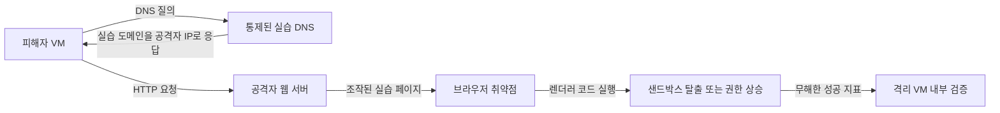

# GNS3 DNS 스푸핑–브라우저 취약점 실습 조사

> 조사일: 2026-10-29  
> 범위: 소유하거나 명시적으로 허가받은 격리 VM 실습 환경

## 결론

DNS 스푸핑만으로 리버스 셸을 얻을 수는 없다. DNS 스푸핑은 피해 브라우저를 공격자가 준비한 웹 서버로 유도하는 단계이고, 그 뒤에 다음 단계가 모두 성공해야 OS 수준 코드 실행으로 이어진다.



따라서 “한 번 접속하면 셸 획득”은 보통 단일 취약점이 아니라 **브라우저 RCE + 샌드박스 탈출/권한 상승 + 후속 페이로드** 체인이다. 버전이 일치해도 OS 빌드, 패치, CPU 아키텍처, ASLR 및 브라우저 완화 기능에 따라 재현 결과가 달라진다.

또한 HTTPS 사이트는 DNS 응답만 바꿔도 인증서가 일치하지 않는다. HSTS, 인증서 고정, Secure DNS/DoH가 적용된 환경에서는 투명한 리디렉션이 더 어렵다. 실습에는 외부 도메인을 사칭하지 않고 예약 도메인인 `victim.lab.test` 같은 이름과 HTTP를 사용한다.

## 후보 버전 비교

| 우선순위 | 피해자 환경 후보 | 취약점 체인 | 공식 영향 범위 | 판단 |
| --- | --- | --- | --- | --- |
| 1 | Windows x64 격리 VM + Firefox 67.0.2 x64 | CVE-2019-11707 + CVE-2019-11708 | Firefox `< 67.0.3` 및 `< 67.0.4`; 두 취약점이 겹치는 버전은 67.0.2 이하 | 브라우저 RCE와 샌드박스 탈출의 역할을 분리해 설명하기 좋다. 공개 자료에 Windows 64-bit 체인이 있으나 특정 Windows 빌드에서의 성공을 Mozilla가 보장하지는 않는다. |
| 2 | Windows 7 SP1 32-bit, 2019-04-09 보안 업데이트 미적용 + Chrome 72.0.3626.119 | CVE-2019-5786 + CVE-2019-0808 | Chrome `< 72.0.3626.121`; Windows 7 SP1 32-bit/x64 | 실제 악용 체인으로 공개된 조합이다. Blink 코드 실행 뒤 Win32k 권한 상승을 사용한다. 오래된 Chrome 설치 파일의 출처와 무결성 확보가 어렵다. |
| 3 | Windows 7 SP1 또는 당시 지원 Windows + IE11, 2020-02 보안 업데이트 미적용 | CVE-2020-0674 | IE11이 설치된 Windows 7 SP1, 8.1, Windows 10 여러 버전 등 | 공식 분류는 원격 코드 실행이다. Protected Mode, ASLR 등 완화 기능 때문에 “페이지 접속 즉시 OS 셸”을 보장하는 단일 단계로 보면 안 된다. |
| 연구용 | Windows 10 1909 빌드 18363.1621 미만 + Chrome 90.0.4430.84 이하 | CVE-2021-21224 + CVE-2021-31955 + CVE-2021-31956 | Chrome `< 90.0.4430.85`; 관련 Windows 커널 취약점 패치 전 빌드 | 브라우저 RCE, 정보 노출, 샌드박스 탈출/권한 상승이 분명하지만 3단계라 수업용 재현 난도가 높다. |

### 후보 1: Firefox 67.0.2 체인

- [CVE-2019-11707](https://www.cve.org/CVERecord?id=CVE-2019-11707)은 `Array.pop` 처리 중 발생하는 타입 혼동 취약점이다. Firefox 67.0.3과 ESR 60.7.1에서 수정됐다. Mozilla는 실제 표적 공격에서 악용됐다고 밝혔다.
- [CVE-2019-11708](https://www.cve.org/CVERecord?id=CVE-2019-11708)은 손상된 콘텐츠 프로세스가 `Prompt:Open` IPC 매개변수를 악용해 비샌드박스 부모 프로세스에 영향을 주는 취약점이다. Firefox 67.0.4와 ESR 60.7.2에서 수정됐다.
- 두 취약점이 모두 남아 있는 명확한 교집합은 Firefox **67.0.2 이하** 또는 ESR **60.7.0 이하**다.
- 특정 Windows 버전은 공식 CVE 영향 범위에 고정돼 있지 않다. Windows 7 SP1 x64 같은 오래된 VM을 후보로 삼을 수 있지만, 실제 호환성은 선택한 공개 연구 자료와 동일한 빌드에서 따로 확인해야 한다.

이 후보가 프로젝트 설명에는 가장 적합하다. 브라우저 내부 메모리 취약점과 샌드박스 탈출을 각각 관찰할 수 있고, OS 커널 취약점까지 필수로 요구하지 않기 때문이다.

### 후보 2: Chrome 72 + Windows 7 SP1 체인

- [CVE-2019-5786](https://www.cve.org/CVERecord?id=CVE-2019-5786)은 조작된 HTML 페이지로 유발되는 Blink 객체 수명 문제다. Chrome **72.0.3626.121**에서 수정됐다.
- [CVE-2019-0808](https://www.cve.org/CVERecord?id=CVE-2019-0808)은 Windows Win32k 메모리 객체 처리의 로컬 권한 상승 취약점이다. Windows 7 SP1 32-bit/x64와 Windows Server 2008 계열이 영향받았다.
- Google은 두 취약점이 실제로 결합돼 사용됐으며 Windows 7 32-bit가 관찰 대상이었다고 공개했다.
- 역사적 조건에 가까운 후보는 **Windows 7 SP1 32-bit, 2019-04-09 패치 미적용, Chrome 72.0.3626.119**다.

이 조합은 “브라우저 렌더러 → OS 권한 상승” 경로가 명확하지만, 오래된 Chrome 바이너리를 비공식 배포처에서 받는 것은 피해야 한다. 신뢰 가능한 원본과 해시를 확보하지 못하면 이 후보는 사용하지 않는다.

### 후보 3: Internet Explorer 11

[CVE-2020-0674](https://www.cve.org/CVERecord?id=CVE-2020-0674)는 Internet Explorer 스크립팅 엔진의 메모리 손상 RCE다. Windows 7 SP1의 IE11을 포함한 여러 당시 지원 Windows/IE 조합이 영향을 받았고 2020년 2월 보안 업데이트로 수정됐다. 단일 RCE CVE라는 점은 단순하지만, 브라우저 보호 모드와 OS 완화 기능을 우회해야 안정적인 네이티브 프로세스 실행으로 이어질 수 있다. 따라서 프로젝트의 주 후보보다는 비교 사례가 적합하다.

## 권장 GNS3 구성

```text
[공격자/웹·DNS VM] 10.10.10.20
          |
    [GNS3 Ethernet switch] ---- [패킷 관찰 VM] 10.10.10.40 (선택)
          |
[피해자 Windows VM] 10.10.10.30
```

- GNS3의 내부 스위치만 사용하고 Cloud/NAT 노드는 연결하지 않는다.
- 공격자, 피해자, 관찰 VM은 모두 스냅샷을 만든다.
- 외부 인터넷과 캠퍼스 네트워크로 나가는 NIC는 실습 중 비활성화한다.
- `victim.lab.test`처럼 실습 전용 이름을 사용하고, 실존 서비스 도메인은 사용하지 않는다.
- DNS 변조 전후 응답과 HTTP 요청을 PCAP으로 남긴다.
- 피해 VM의 시간 동기화, 자동 업데이트, 브라우저 자동 업데이트는 격리 상태에서 통제한다.
- 오래된 OS와 브라우저 설치 파일은 공급자 서명과 해시를 기록하고, 검증되지 않은 제3자 바이너리는 사용하지 않는다.

## 단계별 검증 기준

1. **네트워크 기준선**: 피해자가 정상 실습 DNS 응답을 받고, 공격자 서버에는 접속하지 않는 상태를 PCAP으로 기록한다.
2. **DNS 유도 확인**: 통제된 DNS 변경 후 `victim.lab.test`가 공격자 VM의 주소로 해석되는지 확인한다.
3. **웹 전달 확인**: 공격자 웹 서버 로그와 PCAP에서 피해 브라우저의 HTTP 요청을 확인한다.
4. **브라우저 단계 확인**: 선택한 CVE 연구용 테스트가 정확한 브라우저 버전에서만 반응하고 수정 버전에서는 반응하지 않는지 비교한다.
5. **샌드박스 경계 확인**: 렌더러 내부 동작과 부모/OS 수준 동작을 별도 성공 조건으로 기록한다.
6. **무해한 최종 지표**: 리버스 셸 대신 격리 VM 안에서만 보이는 미리 정한 프로세스 실행, 마커 또는 단방향 콜백을 사용한다. 명령 실행 기능, 지속성, 외부 C2 연결은 포함하지 않는다.
7. **복구 확인**: 실습 직후 VM을 스냅샷으로 되돌리고 네트워크 캡처와 관찰 결과만 보존한다.

수정 버전에서도 같은 테스트를 실행하는 것이 중요하다. 취약 버전에서만 현상이 나타나고 패치 버전에서 사라져야 DNS 문제, 단순 브라우저 충돌, 실제 취약 동작을 구분할 수 있다.

## 프로젝트 산출물 제안

- GNS3 토폴로지와 각 인터페이스/IP 표
- 피해 OS 빌드, 패치 날짜, 브라우저 전체 버전 및 아키텍처
- DNS 변경 전후 PCAP
- HTTP 서버 접근 로그
- 취약 버전과 수정 버전의 대조 결과
- 브라우저 프로세스 경계와 샌드박스 탈출 필요성을 설명한 흐름도
- 실습 전후 VM 스냅샷 식별자와 파일 해시
- 외부망 차단 및 허가 범위를 증명하는 안전 체크리스트

## 안전 범위

이 저장소에는 작동하는 브라우저 익스플로잇, 샌드박스 탈출 코드, 리버스 셸 페이로드 또는 DNS 변조 명령을 포함하지 않는다. 실습은 본인이 소유하거나 담당 교수가 명시적으로 허가한 VM에서만 수행하고, 결과 확인은 격리망 내부의 무해한 지표로 제한한다.

## 공식·권위 자료

- Mozilla Foundation Security Advisory 2019-18: <https://www.mozilla.org/security/advisories/mfsa2019-18/>
- Mozilla Foundation Security Advisory 2019-19: <https://www.mozilla.org/security/advisories/mfsa2019-19/>
- Chrome Stable Channel Update (2019-03): <https://chromereleases.googleblog.com/2019/03/stable-channel-update-for-desktop.html>
- Google Security Blog, Windows 7 exploit chain 공개: <https://security.googleblog.com/2019/03/disclosing-vulnerabilities-to-protect.html>
- Microsoft MSRC CVE-2019-0808: <https://msrc.microsoft.com/update-guide/vulnerability/CVE-2019-0808>
- Microsoft MSRC CVE-2020-0674: <https://msrc.microsoft.com/update-guide/vulnerability/CVE-2020-0674>
- Chrome Stable Channel Update (2021-04): <https://chromereleases.googleblog.com/2021/04/stable-channel-update-for-desktop_20.html>
- Microsoft MSRC CVE-2021-31955: <https://msrc.microsoft.com/update-guide/vulnerability/CVE-2021-31955>
- Microsoft MSRC CVE-2021-31956: <https://msrc.microsoft.com/update-guide/vulnerability/CVE-2021-31956>

버전 범위는 Mozilla, Google, Microsoft가 CNA로 제출한 CVE 기록과 각 공급자 권고를 기준으로 작성했다.
